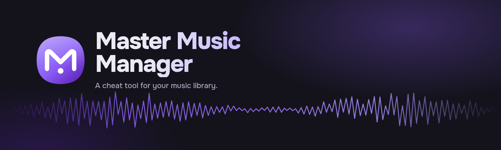

<p align="center"></p>

<p align="center">
  <b>Manage, tag, play and share your music library.</b><br>
  For <b>Navidrome</b>, <b>Jellyfin</b>, any <b>OpenSubsonic</b> server, or just a folder.
</p>

<p align="center">
  <a href="https://github.com/Master3307/master-music-manager/releases"></a>
  <a href="https://github.com/Master3307/master-music-manager/actions"></a>
  <a href="LICENSE"></a>
</p>

## Install

One line, on Linux (Debian, Ubuntu, Arch, Fedora, Proxmox containers …):

```bash
curl -fsSL https://mm-install.master3307.org | bash
```

It installs what’s missing (Node 22, FFmpeg …), puts the app in `/opt/master-music-manager` (or your home folder without root), starts it with the computer and prints the address to open. The rest of the setup happens in the browser, and it finds your Navidrome and music folders by itself.

<details>
<summary>Options, and other ways</summary>

```bash
curl -fsSL https://mm-install.master3307.org | bash -s -- --port 4545 --no-service
#   --dir <path>   where to install       --port <n>     web port (4545)
#   --no-service   don't start with the computer
#   --no-extras    skip spotDL / Chromaprint / archive tools
#   --uninstall    remove the app (music and data stay)
```

The same script is at `https://raw.githubusercontent.com/Master3307/master-music-manager/master/install.sh`.

By hand:

```bash
git clone https://github.com/Master3307/master-music-manager.git
cd master-music-manager
pnpm install
pnpm setup      # port, data folder, start with the computer
pnpm start
```

Needs Node 22+ and FFmpeg. Optional: spotDL (Spotify links), yt-dlp (YouTube and ~1800 sites; the app can install it), Chromaprint `fpcalc` (recognizing songs), `bsdtar` or `7z` (more archive types).

</details>

**Updating:** Settings → System & updates → Update, or `mmm update`, or run the installer again.

## What it does

**Listen**
- A player built in: queue, shuffle that really shuffles, crossfade, speed, A–B loop, sleep timer, 10-band equalizer, loudness leveller, synced (also word-by-word) lyrics, visualizer, bookmarks, a trash bin for songs you never want to hear, media keys.
- Plays through your server like any other app (plays are counted), or straight from the files when there is no server or it’s down. Songs that can’t play are retried and then skipped.
- Animated covers, made from music videos, like Spotify’s Canvas.
- Quick play: one click for shuffle-all, recently added, favorites, or anything you pin (an artist, a genre, a playlist).

**Manage**
- A track table for tens of thousands of songs, with a filter language (`artist:"daft punk" year>2000 -has:cover filename:*remix*`), and editing of every tag for one song or a thousand at once.
- A command line for your library: `replace artist " & " " / "`, `set genre = Phonk where artist:kordhell`, `case title title`, `parse "{track} - {title}"`, `organize`. Every command shows what would change first.
- Files sorted as `Artist/Album/01 - Title` (or any layout you like), with artist separators (`" / "` by default), names that are never split (“Simon & Garfunkel”), and a `!Misc` folder for unknown songs if you want one.
- Covers (upload, link, paste, a frame of a video) with an image editor. Animated GIFs stay animated, even after editing. Lyrics editor with tap-to-sync and lookups. Audio editor: trim, cut, fades, loudness, speed, pitch, EQ, nightcore, slowed + reverb and more, with restore points for every change.
- Duplicates: identical audio is found even when the tags differ. Look-alikes can be played side by side before you choose which one stays.
- **Fill in everything**: paste any links (Spotify, YouTube, Deezer, Apple Music, MusicBrainz, Bandcamp …), drop a file, or nothing at all. It merges what they say, adds what it finds by itself (MusicBrainz in depth: people, label, catalog number, barcode, track and disc counts, every id; Deezer; Apple Music), measures BPM and key from the sound, offers covers and lyrics to look at first, and lets you choose where sources disagree. Recognizing songs from their sound uses AcoustID, with unofficial Shazam as an option.
- Replace a song’s audio (a file or any link) and keep its tags, cover and lyrics.
- Smart playlists (Navidrome rules) with a visual editor and a live preview.

**Add**
- Paste Spotify, YouTube Music, YouTube, SoundCloud, Bandcamp … links, or `youtube-link|spotify-link` for YouTube’s audio with Spotify’s names and cover.
- Drop files, whole folders or archives (zip, rar, 7z, tar, also archives inside archives). Big files upload in parts and resume.
- Paste a link anywhere in the app to get it, drop files anywhere to upload them, or share a link to the installed app from your phone.
- Add a folder and leave the files where they are; take songs out of the app without touching their files.
- Everything waits for a quick check before it goes into your library, and you choose the format (MP3 by default, lossless stays lossless).

**Share and more**
- Share songs, albums, artists, playlists and radio stations, publicly or with a key, with or without downloads, and with proper previews in Discord and chats. Navidrome’s own shares are listed too.
- Listening stats and Wrapped cards. Import your history from Last.fm, ListenBrainz, Spotify, Rockbox logs, Navidrome or any CSV / JSON.
- Several servers and folders. Several computers linked together: they share song lists, play each other’s songs, back each other up, and keep working when one is off.
- Keep places completely in sync: two servers, folders or computers each end up with every song of the others (compared by sound, so nothing is copied twice), optionally with edits and removals following.
- Accounts with roles (admin, user, visitor), two-step login, Discord login, logging in with your Navidrome / Jellyfin account, and a mode where anyone can listen but only you can change things.
- Installs as an app on phones and computers (shortcuts, share target, works offline to start).
- Themes, your own CSS themes (with a header for name, author, version and an update address), sharing themes with a link, a simple player mode, light and dark.
- WebDAV, backups, a full privacy mode (nothing leaves your network) and the `mmm` command.
- Read-only API keys for dashboards (HomeSite, Homarr, Homepage …): what’s playing, library numbers, new albums, search and covers under `/api/integration`.

## The Navidrome plugin

Optional, recommended. It runs inside Navidrome and:
- sends every play to Master Music Manager the moment it happens, from every app, not just this one;
- copies Navidrome’s whole listening history once, with times;
- shows the artist texts you write in Master Music Manager inside Navidrome.

Install it with `mmm plugin` on the Navidrome machine, or download `master-music-manager.ndp` from the [releases](https://github.com/Master3307/master-music-manager/releases?q=plugin) into Navidrome’s plugin folder. Then follow Settings → Navidrome plugin in the app; it gives you a ready command.

## The command line

```text
mmm status            is it running, version, addresses
mmm update            update and restart
mmm logs -f           follow the log
mmm scan --full       read every library folder again
mmm backup out.json   settings, accounts, playlists… (no music)
mmm password <user>   new password for someone
mmm open-login        turn "require logging in" off if you locked yourself out
mmm doctor            check FFmpeg, spotDL, yt-dlp, permissions
mmm service on|off    start with the computer
mmm plugin            install the Navidrome plugin here
```

<details>
<summary>Filter language</summary>

| Write | Finds |
|---|---|
| `daft punk` | words in title, artist, album or file name |
| `artist:"daft punk"` | a field contains |
| `genre=house` | exactly (any case) |
| `filename:*remix*` | wildcards: `*` anything, `?` one character |
| `title~/^intro$/i` | a regular expression |
| `year>=2010` `year:2000..2009` | compare, ranges |
| `duration:3:00..5:00` `size>10MB` | lengths and sizes |
| `added:30d` | added in the last 30 days |
| `-genre:rock` `NOT has:cover` | leave out |
| `a OR b` `(x OR y) z` | or, groups |
| `missing:album` `is:lossless` | empty fields, flags |
| `tag.MOOD:chill` | any custom tag |
| `sort:-year,album` | sorting |

</details>

<details>
<summary>Theme header</summary>

```css
/* ==MMMTheme==
@name        Neon Nights
@author      You
@version     1.2.0
@description Pink accents on deep navy
@license     MIT
@updateURL   https://your.server/share/AbCdEf1234/theme.css
@base        midnight
==/MMMTheme== */
:root { --accent: #ff4d8d; }
```

Share a theme from Settings → Look, and everyone who installed it gets your changes.

</details>

## Development

```bash
pnpm install
pnpm dev          # server with restarts + web app with hot reload (http://localhost:5173)
pnpm test
pnpm brand        # draws the logo, icons, social card and banner from code
pnpm plugin:build # the Navidrome plugin (TinyGo, or Docker)
```

Server: Node 22, Express 5, SQLite (better-sqlite3), music-metadata, FFmpeg. Web: React 19 and Vite. Plugin: Go with Navidrome’s PDK (Extism / WebAssembly).

## License

[Apache 2.0](LICENSE). See [NOTICE](NOTICE). Made by [MrKoby07](https://home.master3307.org).
